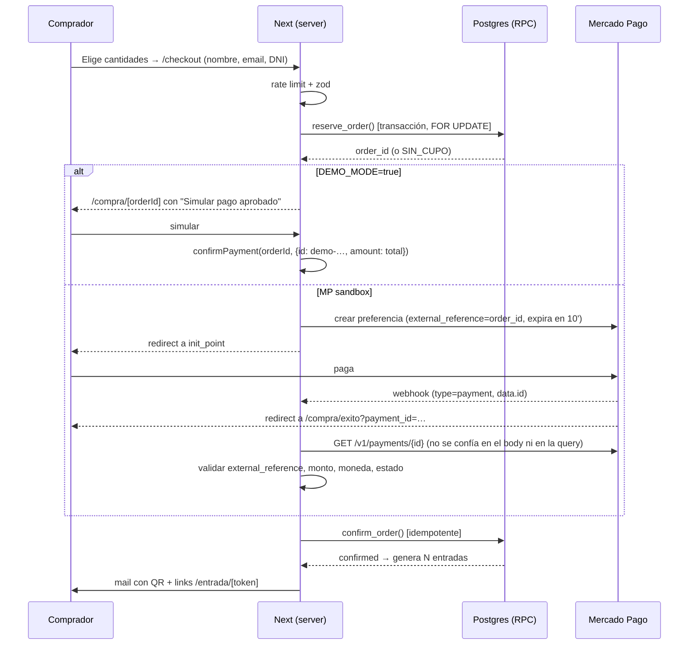

# SPEC — Ticketera "Algo Lindo" (MVP de validación)

> Estado: **borrador para aprobar**. No hay código todavía.
> Las decisiones que no estaban en el brief están marcadas con **[D]** y explicadas en `DECISIONES.md`.

---

## 1. Stack y estructura

| Pieza | Elección |
|---|---|
| App | Next.js 15 (App Router) + TypeScript + Tailwind v4 |
| Datos | Supabase **en la nube, plan free** (Postgres + Auth + Storage) **[D1]** |
| Pagos | Mercado Pago Checkout Pro, SDK oficial `mercadopago` (credenciales de test) |
| Mails | Resend; sin `RESEND_API_KEY` → el mail se imprime en consola |
| Validación | zod (server actions y route handlers) |
| QR | `qrcode` (generar) + `qr-scanner` (leer con la cámara) |
| Tests | Vitest + `pg` contra un Postgres real (`TEST_DATABASE_URL`) |

```
/
├─ SPEC.md · DECISIONES.md · README.md · .env.example
├─ supabase/migrations/      # SQL versionado (compatible con Supabase CLI)
├─ scripts/migrate.ts        # npm run db:migrate  (aplica migraciones vía DATABASE_URL)
├─ scripts/seed.ts           # npm run seed
├─ src/
│  ├─ app/                   # rutas (ver §3)
│  ├─ config/brand.ts        # nombre, logo, textos de marca, WhatsApp
│  ├─ styles/theme.css       # ÚNICO lugar con colores/tipografías (CSS vars → Tailwind)
│  ├─ lib/
│  │  ├─ supabase/           # clientes: browser (anon), server (anon+cookies), admin (service role, server-only)
│  │  ├─ orders.ts           # reservar / confirmar (llama a las RPC)
│  │  ├─ mercadopago.ts      # crear preferencia, consultar pago, verificar firma
│  │  ├─ tickets.ts          # firmar/verificar token HMAC, códigos
│  │  ├─ email.ts            # Resend o consola
│  │  ├─ rate-limit.ts
│  │  └─ auth.ts             # requireAdmin()
│  └─ components/
└─ tests/
```

Reskin: todo lo visual sale de `theme.css` (variables `--color-*`, `--font-display`, `--font-body`) mapeado a tokens de Tailwind, más `brand.ts` (nombre, logo SVG, redes). Cambiar la identidad = tocar esos dos archivos.

---

## 2. Modelo de datos

Dinero en **pesos enteros** (`integer`, sin centavos) **[D2]**. Fechas en `timestamptz`, se muestran en `America/Argentina/Buenos_Aires`.

### `events`
| columna | tipo | notas |
|---|---|---|
| id | uuid PK | |
| slug | text unique | para la URL `/eventos/[slug]` |
| name | text | |
| description | text | texto plano con saltos de línea |
| flyer_path | text null | path en el bucket `flyers` |
| starts_at | timestamptz | fecha y hora |
| venue_name | text | ej. "Club Atlético Fernández Fierro" |
| venue_address | text | |
| is_published | boolean default false | |
| created_at / updated_at | timestamptz | |

"Pasado" = `starts_at < now()`; no hace falta columna. Un evento pasado se puede ver pero no se puede comprar.

### `ticket_types`
| columna | tipo | notas |
|---|---|---|
| id | uuid PK | |
| event_id | uuid FK → events | on delete cascade |
| name | text | "Anticipada", "General" |
| price | integer > 0 | pesos |
| capacity | integer ≥ 0 | cupo |
| sort_order | integer | |

### `orders`
| columna | tipo | notas |
|---|---|---|
| id | uuid PK | también es la `external_reference` de MP |
| event_id | uuid FK | |
| buyer_name, buyer_email, buyer_dni | text | |
| total | integer | lo calcula la RPC, nunca el cliente |
| status | enum `pending` \| `paid` \| `needs_refund` | ver §4.4 |
| expires_at | timestamptz | `created_at + 10 min` |
| mp_preference_id | text null | |
| paid_payment_id | text null | id del pago que la confirmó (`demo-…` en modo demo) |
| paid_at | timestamptz null | |
| email_sent_at | timestamptz null | para no reenviar mails |
| created_at | timestamptz | |

"Vencida" es derivado: `status = 'pending' and expires_at < now()`. No se necesita cron para liberar cupo **[D3]**.

### `order_items`
`id`, `order_id` FK, `ticket_type_id` FK, `quantity` (>0), `unit_price` (precio congelado al reservar).

### `payments` — log + clave de idempotencia de MP
| columna | tipo | notas |
|---|---|---|
| mp_payment_id | text PK | **idempotencia**: un pago se procesa una sola vez hasta su estado final |
| order_id | uuid FK null | según `external_reference` |
| status | text | `approved`, `pending`, `rejected`, `refunded`… (último estado leído de la API) |
| amount | integer | |
| outcome | text | qué hicimos: `confirmed`, `already_paid`, `duplicate_payment`, `amount_mismatch`, `no_stock`, `ignored` |
| raw | jsonb | respuesta de la API de MP (para debug) |
| updated_at | timestamptz | |

### `tickets`
| columna | tipo | notas |
|---|---|---|
| id | uuid PK | va firmado dentro del QR |
| order_id, order_item_id, event_id, ticket_type_id | FKs | |
| holder_name | text | arranca con el nombre del comprador; editable desde admin (transferencia manual) |
| code | text unique | código corto legible, ej. `K7M-Q9PX-3RT` (fallback de ingreso manual) |
| status | enum `valid` \| `used` \| `void` | |
| used_at, voided_at | timestamptz null | |
| created_at | timestamptz | |

Restricción `unique (order_item_id, seq)` con `seq` = 1..quantity → imposible generar entradas duplicadas aunque la confirmación corra dos veces.

### `contact_messages`
`id`, `name`, `email`, `event_type` enum (`cumpleanos` \| `privado` \| `otro`), `estimated_date` date null, `message`, `is_read` boolean, `created_at`.

### `gallery_photos`
`id`, `image_url`, `caption`, `sort_order`. Se carga por seed; no hay ABM en el admin (fuera de alcance) **[D4]**.

### `rate_limits`
`key text`, `window_start timestamptz`, `count int` — PK (key, window_start). Rate limit en Postgres para que funcione igual con varias instancias **[D5]**.

### Storage
Bucket `flyers`, lectura pública, **escritura solo server-side** (service role).

### RLS
- **Activado en todas las tablas.**
- `events`: `select` para `anon, authenticated` **solo si `is_published`**.
- `ticket_types`: `select` si su evento está publicado.
- `gallery_photos`: `select` para todos.
- Resto (`orders`, `order_items`, `payments`, `tickets`, `contact_messages`, `rate_limits`): **sin políticas** → nadie con anon key puede leer ni escribir. Todo pasa por el servidor con service role.
- El admin **no** usa políticas especiales: el servidor verifica la sesión + `ADMIN_EMAILS` y recién ahí usa el cliente service role. Esto mantiene RLS simple y sin agujeros.

### Funciones SQL (RPC)
Todas `security definer`, `set search_path = ''`, y **`execute` revocado a `anon`/`authenticated`** salvo donde se aclara.

| función | qué hace |
|---|---|
| `public_availability(event_id)` | devuelve `ticket_type_id, available` de un evento **publicado**. Única RPC ejecutable por `anon` (no expone datos de órdenes). |
| `reserve_order(event_id, items jsonb, name, email, dni, ttl_seconds=600)` | **atómica**: valida evento publicado y futuro; `SELECT … FOR UPDATE` de los `ticket_types` involucrados (ordenados por id, evita deadlocks); calcula `ocupado = vendidos (orders paid) + reservados vigentes (pending y no vencidos)`; si alguno no alcanza → `raise exception 'SIN_CUPO'` con el tipo; si alcanza inserta `orders` + `order_items` con precio congelado y total calculado. Devuelve `order_id`. |
| `confirm_order(order_id, payment_id, amount)` | **atómica e idempotente** (ver §4.3). Genera las entradas. Devuelve un resultado (`confirmed`, `already_paid`, …). |
| `scan_ticket(ticket_id, event_id)` | `UPDATE tickets SET status='used' WHERE id=… AND status='valid' AND event_id=… RETURNING` — dos escaneos simultáneos: solo uno da OK. |
| `rate_limit_hit(key, limit, window_seconds)` | incrementa y devuelve si se pasó. |

---

## 3. Rutas

### Públicas
| ruta | contenido |
|---|---|
| `/` | Hero con la marca, próximos eventos publicados (card: flyer, fecha, lugar, "desde $X", badge "Últimas entradas"/"Agotado"), CTA de contacto. |
| `/eventos/[slug]` | Flyer, descripción, fecha, hora, lugar (link a Google Maps), tipos de entrada con "quedan X" (solo si quedan ≤ 20 **[D6]**, si no "Disponible"), selector de cantidad por tipo, total, botón **Comprar**. Si es pasado: "Este evento ya fue". |
| `/eventos/[slug]/checkout?t=<typeId>:<qty>,…` | Resumen + form nombre / email / DNI. Al enviar: rate limit → zod → `reserve_order` → (MP) crea preferencia y **redirige a MP** / (demo) va a `/compra/[orderId]`. |
| `/compra/[orderId]` | Estado de la orden con cuenta regresiva de la reserva. En demo: botón **"Simular pago aprobado"**. En MP: botón "Ir a pagar" (por si volvió atrás) mientras la reserva esté vigente. |
| `/compra/exito`, `/compra/pendiente`, `/compra/error` | `back_urls` de MP. Leen `external_reference` y `payment_id` de la query **pero no les creen**: consultan el pago a la API de MP y corren la misma lógica que el webhook (§4.3). Así el sandbox funciona en local sin exponer el webhook **[D7]**. Muestran el estado real de la orden desde la base y, si está paga, los links a las entradas. |
| `/entrada/[token]` | Verifica HMAC → muestra entrada: QR grande, código corto, evento, tipo, titular, estado (válida / usada / anulada). |
| `/quienes-somos` | Texto placeholder (en `src/config/brand.ts`) + galería (6 fotos de `gallery_photos`). |
| `/contacto` | Botón WhatsApp (`wa.me` con mensaje precargado) + form (nombre, mail, tipo de evento, fecha estimada, mensaje) → rate limit → zod → `contact_messages`. |

### API (route handlers)
| ruta | uso |
|---|---|
| `POST /api/webhooks/mercadopago` | Webhook de MP (§4.3). |
| `GET /api/admin/ventas/export?…` | CSV con los filtros actuales (asistentes). Requiere admin. |
| `POST /api/admin/scan` | Valida y marca entrada. Requiere admin. |

Las acciones de formularios (checkout, contacto, simular pago, ABM admin) son **server actions** con zod.

### Admin (`/admin`, todo mobile-first)
| ruta | contenido |
|---|---|
| `/admin/login` | Email + contraseña (Supabase Auth). Si el email no está en `ADMIN_EMAILS` → "No tenés acceso" y se cierra la sesión. |
| `/admin` | Resumen: próximos eventos con vendidas/cupo y recaudado, consultas sin leer, órdenes `needs_refund` (alerta). |
| `/admin/eventos` | Lista con estado (borrador/publicado/pasado) y toggle publicar. |
| `/admin/eventos/nuevo`, `/admin/eventos/[id]` | Form: nombre, slug (autogenerado), descripción, flyer (upload → Storage), fecha/hora, lugar, dirección, tipos de entrada (nombre, precio, cupo; agregar/quitar). No se puede bajar el cupo por debajo de lo vendido+reservado ni borrar un tipo con ventas **[D8]**. |
| `/admin/ventas` | Pestañas **Órdenes** / **Asistentes**. Filtros: evento, estado, búsqueda (nombre / DNI / mail / código). Totales: entradas vendidas y recaudado del filtro. Botón **Exportar CSV**. |
| `/admin/ventas/[orderId]` | Detalle de la orden + sus entradas: **cambiar titular** y **anular** (con confirmación). Muestra los pagos de MP asociados. |
| `/admin/consultas` | Lista de mensajes (más nuevos primero), marcar como leído, botón para responder por mail/WhatsApp. |
| `/admin/escaner` | Ver §5. |

Protección: `middleware.ts` refresca la sesión de Supabase y manda a `/admin/login` si no hay usuario; además **cada** página/acción admin llama a `requireAdmin()` (sesión válida vía `getUser()` + email en `ADMIN_EMAILS`). El middleware no es la única barrera.

---

## 4. Flujo de compra

### 4.1 Diagrama



### 4.2 Reserva (10 minutos)
- Se reserva **al enviar el form de checkout**, justo antes de ir a MP **[D9]**.
- La reserva es la propia orden `pending` con `expires_at`. Cuenta para el cupo mientras `expires_at > now()`; después deja de contar sola (liberación implícita, sin jobs).
- La preferencia de MP se crea con `expiration_date_to = expires_at` para que MP no deje pagar una reserva vencida.
- Se excluyen medios de pago en efectivo (Rapipago/Pago Fácil) porque se acreditan en días y romperían la reserva de 10' **[D10]**.

### 4.3 Confirmación (webhook, back_urls y demo comparten el mismo código)
`processPayment(paymentId)`:
1. (Webhook) Si `MP_WEBHOOK_SECRET` está seteado, verificar header `x-signature`. Si falla → 401.
2. `GET /v1/payments/{id}` con `MP_ACCESS_TOKEN`. Si la API falla → responder 500 para que MP reintente.
3. Upsert en `payments` con el estado **actual** que devuelve la API (por eso no importa el orden en que lleguen los avisos: siempre actuamos sobre la verdad de MP, no sobre el aviso).
4. Si `status !== 'approved'` → registrar y terminar (la orden queda `pending` hasta vencer; si el usuario reintenta en MP, llega otro pago) **[D11]**.
5. Validar: `external_reference` = una orden existente, `currency_id = 'ARS'`, `transaction_amount === order.total`. Si no → `outcome = amount_mismatch`, no se confirma, queda logueado.
6. `confirm_order(order_id, payment_id, amount)` en una transacción con `SELECT … FOR UPDATE` de la orden:
   - orden ya `paid` con **ese mismo** pago → `already_paid` (aviso duplicado: no hace nada).
   - orden ya `paid` con **otro** pago → `duplicate_payment` (pagó dos veces; se marca para devolver a mano y aparece en el admin).
   - orden `pending` vigente → `paid`.
   - orden `pending` **vencida** (pago tarde) → re-chequea cupo con lock: si hay → `paid`; si no → `needs_refund` (alerta en admin, se devuelve a mano en MP). **Nunca se vende por encima del cupo.**
   - Al pasar a `paid` inserta una entrada por unidad (`unique(order_item_id, seq)` como red de seguridad).
7. Si el resultado es `confirmed` y `email_sent_at` es null → enviar mail y setear `email_sent_at`. Si el mail falla, se loguea y se reintenta en el próximo aviso/visita a `/compra/exito`.
8. Webhook responde 200.

Modo demo: el botón llama a `confirm_order(order_id, 'demo-<uuid>', total)` directamente — mismos pasos 6 y 7. La server action rechaza si `DEMO_MODE !== 'true'`.

Pagos que después se devuelven/contracargan en MP: solo se registra el nuevo estado en `payments`; anular entradas es manual desde el admin (como pide el brief).

### 4.4 Estados
- **Orden:** `pending` → `paid` | (vencida, derivado) | `needs_refund`.
- **Entrada:** `valid` → `used` (escáner) | `void` (admin). Anular **no** devuelve el cupo **[D12]**.

### 4.5 Token del QR
- `token = base64url(ticket_uuid_bytes) + "." + base64url(HMAC_SHA256(TICKET_HMAC_SECRET, "v1:" + ticket_id))` (~66 caracteres, QR chico).
- Verificación con comparación en tiempo constante. Un token alterado o firmado con otro secreto es rechazado antes de tocar la base.
- `/entrada/[token]` y el escáner usan el mismo `verifyTicketToken()`.
- Fallback manual: el **código corto** (aleatorio, 10 caracteres de un alfabeto sin ambiguos) que se imprime bajo el QR. Solo lo acepta el escáner (que requiere admin).

### 4.6 Mail de entradas
Asunto: "¡Listo! Tus entradas para {evento} 🎉". Una sección por entrada con QR (imagen adjunta inline vía `cid`, porque Gmail bloquea `data:` URIs), código corto y botón "Ver entrada" → `/entrada/[token]`. Sin Resend: se imprime en consola el destinatario, asunto y los links.

---

## 5. Escáner (`/admin/escaner`)
- Página mobile a pantalla completa, con `manifest.webmanifest` para "Agregar a inicio" (PWA instalable; sin modo offline, necesita conexión para validar) **[D13]**.
- Arriba: selector de evento (default: el próximo/en curso).
- Cámara trasera con `qr-scanner`; al leer un QR → `POST /api/admin/scan`.
- Respuestas (pantalla completa de color + vibración + sonido corto):
  - 🟢 **"OK, pasa"** — nombre del titular y tipo de entrada.
  - 🟡 **"Ya usada"** — "Entró a las 23:41".
  - 🔴 **"Inválida"** / **"Anulada"** / **"Es de otro evento"**.
- Anti doble lectura: ignora el mismo QR durante 3 s.
- Fallback: input para el código corto (o pegar el token).
- Contador "Ingresaron X de Y".

---

## 6. Seguridad
- RLS en todas las tablas (§2). La anon key solo ve eventos publicados, sus tipos, disponibilidad agregada y galería.
- Reserva, confirmación, escaneo, ABM y lecturas de admin → solo server-side con service role (módulo marcado `server-only`, la key nunca llega al cliente).
- zod en todas las entradas (DNI: 7–8 dígitos; cantidades: enteros 1–20 por tipo **[D14]**; email normalizado).
- Rate limit: checkout 10 intentos / 10 min por IP; contacto 5 / hora por IP.
- `TICKET_HMAC_SECRET`, `MP_ACCESS_TOKEN`, `MP_WEBHOOK_SECRET`, `SUPABASE_SERVICE_ROLE_KEY` solo en env del servidor.
- Uploads de flyer: solo imágenes (jpg/png/webp), máx. 5 MB, nombre generado por el servidor.

---

## 7. Variables de entorno (`.env.example`)
| variable | para qué |
|---|---|
| `NEXT_PUBLIC_SUPABASE_URL`, `NEXT_PUBLIC_SUPABASE_ANON_KEY` | cliente público |
| `SUPABASE_SERVICE_ROLE_KEY` | operaciones server-side |
| `DATABASE_URL` | conexión Postgres para `db:migrate` (string de Supabase) |
| `TEST_DATABASE_URL` | Postgres para tests (idealmente otro proyecto free o un Postgres local) |
| `ADMIN_EMAILS` | lista separada por comas |
| `SEED_ADMIN_PASSWORD` | el seed crea el usuario del primer email de `ADMIN_EMAILS` con esta contraseña |
| `APP_URL` | URL base (back_urls, links en mails) |
| `DEMO_MODE` | `true` / `false` |
| `MP_ACCESS_TOKEN` | access token de **prueba** (`TEST-…`) |
| `MP_WEBHOOK_SECRET` | opcional; verifica `x-signature` |
| `TICKET_HMAC_SECRET` | ≥ 32 bytes aleatorios |
| `RESEND_API_KEY`, `EMAIL_FROM` | opcional |
| `NEXT_PUBLIC_WHATSAPP_NUMBER` | ej. `5491155550000` |

---

## 8. Seed (`npm run seed`)
Borra y recarga datos de ejemplo (nunca toca usuarios salvo crear el admin si no existe):
1. **"Noche de Vinilos & Vermú"** — próximo, publicado, 2 tipos: Anticipada $12.000 (cupo 80) y General $15.000 (cupo 150). Algunas órdenes pagas.
2. **"Cumbia en la Terraza"** — próximo, publicado, 1 tipo General $10.000, cupo 120 con **117 vendidas** (casi agotado).
3. **"Fiesta de Primavera"** — pasado (septiembre), con órdenes pagas y entradas `used`.
4. 6 fotos de galería (placeholders), 2 consultas de contacto (un cumpleaños de 30, un evento privado de empresa), ~12 órdenes con nombres/DNI/mails ficticios creíbles (dominio `example.com`), incluida 1 `needs_refund` y 1 pendiente vencida para que el admin tenga todos los estados.
5. Flyers: SVGs generados (tipográficos, con los colores de marca) subidos al bucket `flyers`.

---

## 9. Tests (Vitest, contra Postgres real)
- **Reserva:** reserva OK; rechaza si supera cupo; la reserva vencida libera cupo; **concurrencia**: 50 reservas en paralelo (50 conexiones) por 1 entrada c/u contra cupo 20 → exactamente 20 OK y 30 `SIN_CUPO`; mezcla de tipos sin deadlocks.
- **Confirmación / webhook:** mismo pago procesado 2 y 10 veces en paralelo → 1 sola orden paga y N entradas exactas; aviso `rejected` después de `approved` no cambia nada; monto distinto → no confirma; pago tarde con cupo → `paid`; pago tarde sin cupo → `needs_refund`; segundo pago distinto → `duplicate_payment`. La API de MP se mockea en los tests del handler.
- **Token QR:** firma/verificación ida y vuelta; token alterado, truncado, con otro secreto o con id cambiado → inválido; escaneo concurrente del mismo ticket → un solo OK.

---

## 10. Hitos
1. Proyecto, migraciones + RLS, seed, web pública con datos reales.
2. Compra completa: reserva atómica, checkout MP + demo, webhook idempotente, entradas QR, mail. Tests de reserva/webhook/token.
3. Panel admin (eventos, ventas, entradas, consultas, export).
4. Escáner.
5. Pulido visual, responsive, estados vacíos/error, README.

Freno al final de cada uno para que pruebes.
